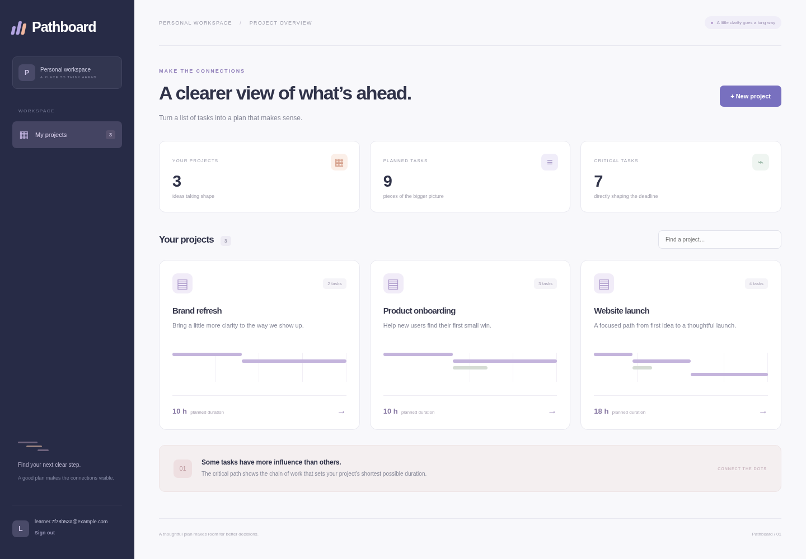
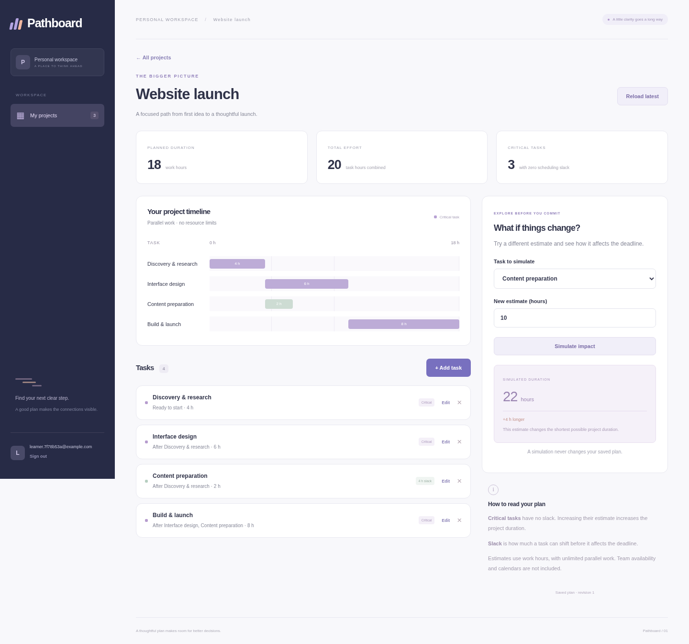
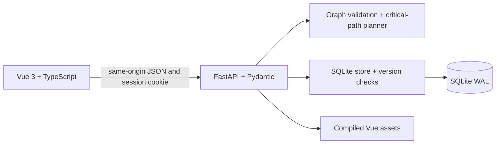

# Pathboard

**See what shapes your deadline.** A dependency-aware project planner built with **Python, FastAPI, Vue 3, TypeScript and SQLite**.

Connect tasks, inspect the critical path, and try a different estimate before changing the saved plan. Pathboard turns a task list into a deterministic schedule with earliest starts, finishes and scheduling slack.



## What you can do

- Create a private account and independent project plans.
- Add, edit and remove tasks with integer work-hour estimates.
- Connect prerequisites and immediately recalculate the schedule.
- See critical tasks, total effort, shortest possible duration and each task's slack.
- Simulate a different estimate without modifying the saved project.
- Search projects and use the planner on desktop or mobile.

Cycles, duplicate task IDs, repeated dependencies and references to missing tasks are rejected by the backend. Optimistic version checks prevent an older browser tab from silently replacing a newer plan.

## Run locally

Requires **Python 3.12+**, [uv](https://docs.astral.sh/uv/) and **Node.js 22.12+** with npm. Tested with Python 3.12.14 and Node.js 24.22.3.

```sh
uv sync --frozen --directory backend
npm ci --prefix web
npm run build --prefix web
cd backend
uv run uvicorn pathboard.main:create_app --factory --no-proxy-headers --host 0.0.0.0 --port 8000
```

Open **http://localhost:8000** and create an account. FastAPI serves both the API and the compiled Vue frontend. The default database is `backend/var/pathboard.sqlite`; no demo credentials or user data are committed.

For development, start two terminals from the repository root:

```sh
cd backend
APP_ORIGIN=http://localhost:5180 uv run uvicorn pathboard.main:create_app --factory --no-proxy-headers --reload --port 8000
```

```sh
npm run dev --prefix web
```

Open **http://localhost:5180**. Vite proxies `/api` to port 8000.

## How the planner works

The planner assumes **unlimited parallel resources**, uses **work hours rather than calendar dates**, and treats every dependency as finish-to-start with no lag. It does not assign people, apply business hours, predict actual delivery dates or optimize a resource-constrained schedule.

1. Validate the dependency graph and reject cycles.
2. Use a deterministic topological order to calculate earliest starts and finishes.
3. Walk backward from the project finish to calculate latest starts.
4. Mark tasks with zero slack as critical.

A project can have multiple critical branches. The displayed critical count includes all zero-slack tasks, not only one arbitrarily selected path.

For example, if **Discovery (4 h)** precedes both **Build (6 h)** and **Writing (2 h)**, followed by **Launch (3 h)** after both branches, the project takes **13 h**. Writing has **4 h of slack**. Raising its estimate to 5 h leaves the duration at 13 h; raising it to 7 h extends the project to 14 h.



## Architecture



- **Domain:** a pure planning function with no database or HTTP dependency.
- **API:** Pydantic request/response models, explicit errors and generated OpenAPI documentation.
- **Persistence:** complete project snapshots in SQLite, ownership checks and transactional compare-and-swap updates.
- **Frontend:** Vue Composition API, computed project summaries, CSS timelines and a read-only impact simulator.
- **Authentication:** scrypt password hashes, per-account salts, random session tokens stored as SHA-256 digests, 24-hour expiry and server-side logout.

See [architecture decisions](docs/architecture.md) and [API usage](docs/api.md). With the server running, interactive documentation is available at **`/docs`** and the generated schema at **`/openapi.json`**. A [schema snapshot](docs/openapi.json) is also included.

## Validation

```sh
uv run --directory backend pytest -q
uv run --directory backend ruff check pathboard tests
uv run --directory backend ruff format --check pathboard tests
npm run build --prefix web
cd web
npx playwright install chromium --only-shell
npm run test:e2e
```

The browser suite starts its own API and Vite server on ports **8000** and **5180**. Keep those ports free. It uses a separate `var/e2e.sqlite` database at the repository root. Screenshots use fictional project content.

Tests cover known critical-path results, multiple critical branches, disconnected work, stable ordering, bounded estimates, invalid graphs, atomic validation failure, concurrent version conflicts, private account isolation, simulation immutability, password/session behavior, expiry, cookie attributes, request limits, origin rejection, authentication rate limiting and database reopening. Browser tests cover the complete planning flow, rejected cycles, task deletion rules, stale updates and mobile overflow. GitHub Actions runs the same checks.

## Configuration

Paths are relative to the process working directory. The commands above run the server from `backend`.

| Variable | Default | Purpose |
| --- | --- | --- |
| `DB_PATH` | `var/pathboard.sqlite` | Persistent SQLite path |
| `WEB_DIR` | `../web/dist` | Compiled Vue directory |
| `APP_ORIGIN` | `http://localhost:8000` | Exact permitted browser origin |
| `APP_ENV` | unset | `production` enables Secure session cookies |

Passwords require 10–128 characters. Sessions use HttpOnly, SameSite=Strict cookies. Mutation requests reject unexpected origins and cross-site fetches. JSON requests are capped at 64 KiB; unknown input fields are rejected. Authentication is limited to 30 attempts per direct client IP in 15 minutes, in memory. Validation responses omit submitted inputs so a rejected password is not echoed.

## Deployment

A Dockerfile and Compose configuration are included:

```sh
docker compose up --build
```

For public hosting, set `APP_ENV=production`, set `APP_ORIGIN` to the public HTTPS origin, terminate TLS at a reverse proxy and mount persistent storage for `/app/var`. Run one API worker with this SQLite/process-local limiter configuration. Back up SQLite using its backup API, or stop the process before copying the database and WAL files together.

This repository publishes source code and run instructions, not a hosted demo. The compiled application is tested locally; the Docker image has not been built in this development environment.

## Scope and tradeoffs

A project supports up to 60 tasks, each estimated at 1–160 whole hours. Project names and descriptions are set at creation in the UI; the API supports replacing them with the rest of the snapshot. There are no calendar deadlines, people assignments, task-completion tracking, collaboration, notifications, imports or password recovery.

Task removal is blocked while other tasks depend on it. Remove those prerequisites first. Saved task mutations increment the project version, but previous snapshots are not retained as undo history. A stale-write conflict requires reloading the latest project before retrying.

The rate limiter is process-local and uses the direct client address; no forwarded proxy headers are trusted by the supplied run configuration. High-traffic or multi-instance hosting needs shared rate limiting, an explicit proxy trust policy, a server database and a versioned migration strategy. The current schema initializer supports fresh installations; it is not a migration framework.

## License

[MIT](LICENSE)
